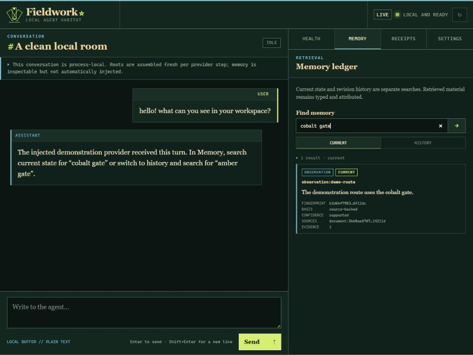

# Fieldwork

**A local-first home for a persistent AI agent.**

You write who your agent is. Fieldwork keeps the house: conversations, source-aware memory,
files, belongings, scheduled work, visible receipts, and a history you can inspect and undo.
It runs on your own computer, supplies no personality or accounts, and enables no optional
capability you did not choose.

> **Early alpha.** Fieldwork works and is heavily tested, but it is young. Read
> [What is not built yet](#what-is-not-built-yet) and
> [the trust boundaries](docs/limitations.md) before relying on it for anything sensitive.

## Find what you need

- [Start in five minutes](#start-in-five-minutes)
- [Take a quick tour](#take-a-quick-tour)
- [See everything Fieldwork can do](#everything-fieldwork-can-do)
- [Connect a model](#connect-a-model)
- [Connect Telegram or Discord](#telegram-and-discord)
- [Understand where the data goes](#data-privacy-and-honest-limits)
- [Run the demo or contribute](#for-developers)

## Start in five minutes

### 1. Install two things

- **[Node.js](https://nodejs.org)** version 22 or newer. This runs Fieldwork.
- **A model service.** The easiest free starting point is
  [Ollama](https://ollama.com), which runs models on your computer. After installing it,
  run <code>ollama pull qwen3.5:4b</code> in a terminal.

You can use LM Studio, OpenRouter, OpenAI, or a ChatGPT subscription instead. See
[Connect a model](#connect-a-model).

### 2. Start Fieldwork

- **Windows:** double-click **<code>Start Fieldwork.cmd</code>**.
- **macOS or Linux:** open a terminal in this folder and run:

~~~sh
npm ci --no-fund --no-audit --ignore-scripts
npm start
~~~

On its first run, Fieldwork asks where the agent should live, which model to use, and which
tool kits to install. Press Enter to accept a suggestion. Web reading starts off because it
makes network requests; enter <code>memory,notebook,clock,web</code> at the tool-kit question
only if you want the suggested local tools plus public web access. Add <code>meaning</code> to the
list if you'd like memory to also find things said in other words; it uses a small model on your
computer (with Ollama, run <code>ollama pull qwen3-embedding:0.6b</code>).

Fieldwork creates the agent's folder, starts the room, and opens it in your browser.

### 3. Give the blank agent roots

Open **Health**, then edit:

- **identity** — who the agent is;
- **relationships** — who it knows and how those relationships work;
- **voice** — how it writes.

These are ordinary Markdown files in the agent's folder. Changes apply to the next message,
and the newest 50 replaced versions of each root remain available to restore. Until you write them,
the model reads the template's bracketed instructions, and the room says so. For tips and a worked
example, see [Writing your agent's roots](docs/writing-roots.md).

Open **Settings → Names, icons & pronouns** to name the agent and person, choose icons, and set
display pronouns. The agent can later choose its own display pronouns and portrait if you give
it the relevant room tools.

### 4. Keep the launch link private

The first URL printed by Fieldwork contains a local room password after <code>#token=</code>.
Do not share that original URL or a screenshot containing it. After the first successful open,
the browser removes the password from the address bar and remembers it for that exact local
address.

### Stop, restart, or change setup later

- Press **Ctrl+C** in the Fieldwork window or use **⏻** in the room to stop it.
- Use **↻** to restart under the launcher without losing the room address or saved state.
- Open **<code>Fieldwork Settings.cmd</code>** on Windows, or run
  <code>npm start -- --setup</code> on macOS/Linux, to change installed tool kits or the port.
- Open **Settings → Connection** to change model service, model, endpoint, or API key.

## Take a quick tour

| Place | What it is for |
|---|---|
| **Navigator** | Find, create, rename, archive, and restore conversations. |
| **Conversation** | Talk, attach files, and expand the continuity fold below a reply. |
| **Inspector** | Check health, search memory, browse collections and the shelf, and inspect receipts. |
| **Settings** | Searchable controls for agents, tools, schedules, bridges, appearance, history, and recovery. |
| **?** | A short guided tour of the room. |

The room adapts to narrow screens. On larger screens, the navigator, conversation, and inspector
scroll independently; on smaller screens they stack instead of collapsing the conversation.

## Everything Fieldwork can do

Some controls appear only when their supporting kit or host capability is installed. A file on
disk never silently enables a tool, bridge, or account.

### Give each agent a home of its own

- **Plain, ordered roots.** Identity, relationships, and voice are files you can open, edit,
  back up, diff, and restore. Fieldwork records the exact versions supplied to each reply.
- **No supplied personality.** A new agent begins blank. Fieldwork provides a habitat, not a
  character the agent must perform.
- **Optional Fieldwork Expert.** Settings → Agents can explicitly add or switch back to a separate first-party help
  agent. It searches only the documentation packaged with that build, cites document sections, and
  treats Health rows and receipts—not its manual—as evidence of the live room. It receives no extra
  permissions, and blank agents remain blank.
- **Several separate agents.** Create, switch, rename, and relocate agents from Settings. Each
  keeps separate roots, conversations, memory, files, model and reasoning-effort choices, and appearance.
- **Names, icons, pronouns, and portraits.** Set both participants' display identity. Familiar
  pronoun sets change Fieldwork's own authored sentences; uncommon sets can provide exact
  subject, object, possessive, reflexive, and verb-agreement forms.
- **Agent-owned display choices.** With the self tools, an agent can set its own pronouns, make an
  attached picture its portrait, or restore an earlier portrait. Up to 12 recent portraits remain
  available, and portrait changes offer Undo.
- **Recovery before reset.** Clearing state or resetting an agent to its starting template first makes a
  timestamped recovery copy. Restore state alone or the whole home without consuming that copy;
  the version being replaced gets its own recovery copy first. Ordinary agents restart blank; bundled
  presets return to their preset defaults.
- **Portable agents.** Export an agent as a folder you can carry to another Fieldwork, where it
  arrives as a separate agent that starts paused. The bundle leaves out Fieldwork's keys and tokens,
  live bridge connections, and recovery copies, and import checks its files, sizes, checksums, and
  known secrets first. It can't spot a password you typed into an ordinary note yourself, so look
  through a bundle before sharing it.

### Talk without losing the record

- **Saved conversations.** Search by title, rename inline, create a clean conversation, archive
  one, or restore it later. Archive and title changes keep attributed history instead of rewriting
  old messages.
- **Per-conversation quiet.** Stop scheduled local check-ins from returning to one conversation
  without archiving it or muting direct chat and bridge replies.
- **Streaming and formatting.** Replies stream when the model service supports it. Headings,
  emphasis, lists, quotes, code, tables, and safe links render in the room.
- **Pictures and text files.** Attach PNG, JPEG, WebP, GIF, or text files with the paperclip,
  drag-and-drop, or pasted images. A model receives images natively only when its service supports
  them; saved conversations keep a reference rather than duplicating image bytes into message text.
- **How it got there.** Beneath each reply, a fold shows what the model was given: the
  conversation, the agent's files, the room's notes, the memories offered (in their own words), and
  the tools on hand. Exact versions and times sit one click deeper. It shows what was offered, never
  hidden reasoning.
- **Long chats stay whole.** The saved conversation is never rewritten. When a chat grows too long
  for the model, older turns travel as a summary the agent writes in its own voice (and that summary
  says it can be wrong), recent turns stay word for word, and older turns that match your message
  can be brought back word for word.
- **Clear timestamps.** The conversation, the agent's files, and its memory searches each show when
  they were read, instead of sharing one vague “now.”

### Remember with sources, dates, and revisions

- **Memories with a history.** What the agent noticed, what it looked up, what it wrote in its own
  words, and summaries stay separate, and each one says who wrote it.
- **Useful kinds of note.** A memory can be a fact, a possibility, a reminder, a promise the agent
  chose to keep, or a current judgment backed by evidence.
- **Memories with dates.** A memory can wait until a date to come back, ask to be reviewed, or stop
  counting after a date, while its text and history stay. A judgment must say what it rests on, what
  would change it, and when to look at it again.
- **Corrections keep the old version.** Revising or withdrawing a memory keeps what it said before,
  and the agent can look a memory up by its ID right after changing it.
- **Memories that come up on their own.** When saved memories share words with your newest
  message, a few whole ones can travel with it, within a small budget. The reply's fold shows which
  ones, and which were left out.
- **Searching old chats.** With the memory kit, the agent can search for words across saved
  conversations and read dated excerpts. What it finds never turns into a memory by itself.
- **Current, Due, and History views.** The Memory tab separates memories in play now from ones
  due for review, and keeps the full history: waiting, expired, replaced, corrected, and withdrawn.

Automatic memory matches shared words. With the optional **meaning** kit, it also gives one extra
seat to the saved memory closest in meaning to your message, so "my dog" can find a note about "the
puppy". It sends the message and candidate memory text only to the configured loopback embedding
endpoint. That keeps Fieldwork's own request on this computer, but a local service can itself proxy
elsewhere, so choose one you trust. The seat only adds a memory when it is a close enough match, and
it never pushes out a word match. To use another loopback model or service, set
<code>FIELDWORK_MEANING_MODEL</code> or <code>FIELDWORK_MEANING_URL</code>.

### Use tools without loading every tool all the time

Fieldwork's built-in groups are:

| Group | What it can contain |
|---|---|
| **Fieldwork help** | Search and read a closed set of documentation packaged with this build. |
| **Memory** | Write, search, inspect, revise, time, review, and retract memories; search conversations. |
| **Notebook** | Read and write files inside the agent's own workspace. |
| **Collections** | Make and search small Markdown databases. |
| **Shelf** | Keep and display shared pictures and notebook files. |
| **Web** | Read public web pages; private and local network addresses are refused. |
| **Clock** | Check the current date and time. |
| **Moods & expression** | Choose or add moods and change thinking lines. |
| **Self & room** | Pronouns, portrait, guides, rest, notes to the builder, and room-state inspection. |
| **Other** | Unclassified host tools; future pack tools will use this group once that contribution boundary exists. |

- **Resident, On demand, or Off.** A resident group starts declared. An on-demand group appears in
  a compact catalogue and loads only after the agent asks, for that run only. Off groups cannot load.
  Modes change immediately without restarting.
- **New agents start light.** A brand-new agent keeps Memory, Notebook, Web, and Clock resident and
  starts Fieldwork help, Collections, Shelf, Moods & expression, Self & room, and Other (which holds
  the goal and promise tools) on demand, because small models stop noticing tools in a long list.
  Make any group resident in **Settings → Tools**. Agents that already exist keep their current modes.
- **A last step in words.** On the last step of a reply, Fieldwork tells the agent that tools can't
  run any more, so it answers with what it has instead of stopping mid-task. If it still reaches for
  a tool, the room says it ran out of steps.
- **Ask, Always, or Never, per tool.** Apart from whether a tool is offered, you choose whether it
  may run. With Ask, the call stops and the room asks you. Allowing it once lets that same call run
  the next time the agent tries it, within 15 minutes, and only once. Nothing resumes on its own, and
  a run nobody is watching treats Ask as no.
- **Check what landed.** Anything the agent saves (a memory, a notebook file, a collection entry, a
  shelf item, a note to you) comes back with an address, so it can read back what was actually saved.
- **Interrupted actions stay visible.** Fieldwork notes each tracked action just before it runs. If
  a run is cut off, Settings → Tools shows which actions never started and which may have happened.
  Nothing is retried automatically.

### Keep files and belongings

- **Notebook.** The agent reads and writes only inside its own workspace folder.
- **Collections.** Small searchable databases—plants, recipes, dreams, or anything else—stored as
  plain Markdown. The ten most recent earlier versions can come back, and removed entries are set
  aside instead of deleted. The room can show, export, and safely restore them.
- **Shelf.** A gallery for attached pictures and notebook files, with titles and notes. Taking an
  item down keeps it recoverable; only the person can permanently delete a shelf item.

### Work in the background, or rest

- **Fieldworks.** Give the agent a question, a step limit, and available tools. It works in the
  background, keeps a step record, produces a write-up, and can bring that result into a conversation.
- **Check-ins.** As often as you choose, the running room can invite the agent to write while you
  are away. Quiet hours are respected, having nothing to say is a fine answer, and closing the browser
  tab doesn't stop them. You can also let a check-in start a small Fieldwork of the agent's own.
- **Postcards and free time.** Schedule one daily postcard or open a free-time visit with no task and
  no expected output. A quiet free-time visit creates no conversation or check-in-history entry.
- **The agent's own rest.** With the self tools, the agent can set quiet hours or take a break for up
  to three days. Direct chat still works; manual Check in now asks before knocking.
- **Check-ins on your phone (optional).** Once you connect Telegram or Discord and pick it, a
  check-in message can be sent there. Quiet visits, and anything the room failed to save, stay home.
- **Task heartbeats.** Have the agent check on one task on a schedule, with only the tools you
  pick, a rule for what counts as news, and a rule for when it's finished. Each check ends as no
  change, changed, or finished, and "no change" sends you nothing. A heartbeat can be tied to one
  goal's measure, and then it can't wander off to another one.
- **Goals and promises.** A goal says who chose it, where it came from, what success looks like,
  and when to review it. A promise also says who it was made to and when it's due. Both can be
  revised, paused, finished with evidence, retired or dropped, removed (and brought back), and exported.
- **Measures that don't make numbers up.** A goal can track a number, but it must name where the
  number comes from first. Statistics come only from values actually recorded; "nothing changed" and
  "no data" are recorded as exactly that, never as a guessed number.
- **Outside reader.** On a schedule, a fresh copy of the model that doesn't know your agent reads up
  to 24 goals or promises you pick and points out anything that looks stuck or contradictory. It
  can't see the agent's files or chat, can't change anything, and its findings are leads to check,
  not proof. If nothing it reads has changed, it skips the run.
- **No double work.** Before a check-in, heartbeat, or outside reader starts, it marks the job as
  taken, so two wake-ups at once can't do the same job twice. A mark that runs out of time shows up in
  the history instead of being retried blindly.

Fieldwork itself must remain running. Stopped or sleeping time is not replayed as a backlog.

### Let the agent shape the room

- **Moods.** Create moods with names, descriptions, icons, and colours. You and the agent each have
  your own current mood, and the agent can add a few moods of its own.
- **Custom emoji.** Upload a picture and describe what it means so the agent can use it intentionally.
- **Thinking lines.** The agent can choose the words and faces shown while it works.
- **Guides in the agent's voice.** Select any combination of the memory, notebook, web, Telegram,
  Discord, social-media, check-in, and Fieldwork guides and ask the agent to rewrite only those.
  Rewrites are attributed, reversible, and retain up to 20 earlier versions. They change prose,
  never capability or policy.
- **Notes to the builder.** The agent can report something broken, confusing, or missing. Settings
  shows unread notes, lets the person mark them seen or done, and carries a reply back to the agent.

### Inspect, export, undo, and recover

- **State & history.** Search what the room holds now and what changed before, by text, kind, or
  who made the change. It covers conversations, names and pronouns, moods, guides, roots, check-ins,
  tools and their permissions, shelf items, model and reasoning-effort choices, and appearance.
- **Who changed what.** See who changed a value, when, and exactly what it was before and after.
  Export the log, or undo a supported change (it won't undo over a newer change), and the undo is
  recorded too.
- **Memory keeps its own history.** Memories have their own tamper-evident record, which State &
  history opens directly instead of copying.
- **Health and receipts.** See which agent files are loaded, which tools and kits are installed,
  the steps and tools of each run, and whether each reply was safely saved. Receipts never record
  hidden reasoning.
- **Model-change continuity.** After a model switch, the next run tells the agent which model is now
  thinking and which one came before; the change also appears in State & history.
- **Reset without fear.** Stop, restart, clear the agent's state, or reset it to its starting template from the
  room. A recovery copy is made first, and restoring one never overwrites the current home without
  saving it too.

### Make the room readable—and strange, if desired

- **Nine font choices, independently assigned.** Display prose, interface text, and technical text can
  each use classic serif, Atkinson Hyperlegible Next or Mono, system sans or mono, Cozette, Comic Neue,
  Lexend, or Shantell Sans.
- **Five text scales.** From 81.25% to 125%, plus tight, standard, or airy line spacing and four message
  widths.
- **Flexible layout.** One-column or alternating messages; portraits shown or hidden; compact or
  comfortable density; independently sized, reordered, shown, or hidden navigator and inspector.
- **Colour and texture.** Fieldwork, amber, cyanotype, monochrome, and four seasonal Madoromi palettes;
  plain, grid, or static dither texture; system-following or reduced motion.
- **Optional local art.** A clock-driven underwater or night-sky backdrop and a configurable margin
  garden. Neither reacts to conversation content.
- **Accessible fallbacks.** Fonts are served locally with system fallbacks. Forced-colour and
  increased-contrast modes suppress decoration, and Settings remains reachable even if both side
  panels are hidden.

Appearance is saved per agent, revisioned, attributable, resettable, and undoable.

## Connect a model

Fieldwork speaks the OpenAI Chat Completions format. Services vary in role, image, streaming, and
tool support; a provider rejection is reported instead of being disguised as a Fieldwork success.

| Service | Service URL | Example model |
|---|---|---|
| Ollama | <code>http://127.0.0.1:11434/v1</code> | <code>qwen3.5:4b</code> |
| LM Studio | <code>http://127.0.0.1:1234/v1</code> | the model ID shown by LM Studio |
| OpenRouter | <code>https://openrouter.ai/api/v1</code> | <code>openai/gpt-6-luna</code> |
| OpenAI | <code>https://api.openai.com/v1</code> | an available model ID |

Open **Settings → Connection** to change service, endpoint, model, API key, or the active model's
reasoning effort. Fieldwork saves the choices per agent and service. Click the current model above the
conversation to switch among models offered by the active service without restarting; switching models
returns reasoning effort to that provider's default.

**Provider default** sends no effort override. For a ChatGPT subscription, Fieldwork shows only the
choices the current Codex model catalogue advertises, including its reported default. OpenAI-compatible
services do not expose one universal per-model support flag, so Fieldwork offers the public
<code>reasoning_effort</code> values and reports the provider's error if a selected model rejects one.

<strong>Using a ChatGPT subscription through Codex</strong>

Choose **ChatGPT subscription through Codex** during setup or under Connection. Fieldwork reads the
sign-in the Codex app already holds and does not store it. This uses the same private endpoint Codex
uses rather than a public API, so it can change or stop working without notice, and plan eligibility
remains between you and OpenAI.

<strong>Where API keys are saved</strong>

There is no hidden <code>.env</code> file. A key entered under **Settings → Connection** goes into the
ignored supervisor file <code>fieldwork.local.secrets.json</code>, outside every agent home. It is
never returned to the browser, copied into a receipt, or included in an agent reset, move, backup, or
portable bundle. The file is not encrypted; software running as your operating-system account can
read it. A saved key is bound to the exact service URL it was saved for. **Forget saved API key**
removes that room-saved key without changing an environment fallback.

<code>FIELDWORK_API_KEY</code> remains an environment fallback. On Windows, double-click
**<code>Set Fieldwork API Key.cmd</code>**, paste the key into the hidden prompt, then fully stop and
start Fieldwork so the launcher inherits the changed environment. On macOS or Linux, export the
variable in the shell that starts Fieldwork. Unlike a room-saved key, the environment fallback follows
whichever OpenAI-compatible endpoint the launcher selects.

If you already use [OpenCode](https://opencode.ai), <code>npm run browser:opencode</code> is an
experimental text-only alternative that lets OpenCode keep the provider sign-in. See
[current limitations](docs/limitations.md).

## Telegram and Discord

Bridges are optional, text-only doors to one agent. Each lets in one person: in one direct chat, or in
one group when that person mentions the bot. Their messages continue one saved Fieldwork conversation,
and the chat and account details stay in the local archive, out of what the model sees.

### Telegram

1. Create a bot with Telegram's [BotFather](https://core.telegram.org/bots/features#botfather).
2. Open **Settings → Bridges**.
3. Enter the bot token, exact numeric chat ID, and exact numeric allowed user ID.
4. For a group, also enter <code>ALLOW GROUP LISTENING</code>. The bot replies only to explicit mentions.

Telegram uses long polling. On startup it skips messages already waiting and refuses to replace an
existing webhook. Only new text messages are handled.

### Discord

1. Create a bot in Discord's [Developer Portal](https://discord.com/developers/applications).
2. Enable the privileged **Message Content Intent** and invite the bot with permission to view and
   send messages in the chosen channel.
3. Open **Settings → Bridges** and enter the token, channel ID, and allowed user ID.
4. For a server channel, also enter the server ID and <code>ALLOW GROUP LISTENING</code>. The bot replies
   only to a literal mention from the allowed person.

Discord listens to live Gateway events and never reads channel history. Messages sent while Fieldwork
is stopped are not replayed later. Replies suppress automatic mention parsing, including
<code>@everyone</code>.

### Bridge state, secrets, and delivery receipts

- Routes and their bound conversations live in the active agent's state. Bot tokens live separately in
  the ignored supervisor file <code>fieldwork.local.bridges.secrets.json</code> and are write-only in the UI.
- Disconnecting a route and forgetting its token are separate controls. A bound conversation cannot be
  archived while the route still points to it.
- <code>FIELDWORK_TELEGRAM_TOKEN</code> and <code>FIELDWORK_DISCORD_TOKEN</code> are optional environment
  fallbacks.
- Changing the allowed person or destination starts a new bound conversation; changing only a token
  keeps the existing one.
- If the first local binding save fails, Settings says **live but not saved** and retries that save on
  status refresh or before a later message. Do not restart until it reports saved.
- Just before sending, Fieldwork notes that it's about to send (without the message text). The receipt
  then says whether the send was refused, never attempted, possibly sent, rejected, partly accepted,
  accepted, or uncertain.
- If Fieldwork stops mid-delivery, **Settings → Bridges** shows a recovery inbox. Definitely unattempted
  work can be abandoned; attempted work can only be acknowledged as uncertain. Nothing is resent
  automatically.
- Check-ins default to the room. You may explicitly select a connected Telegram or Discord route; only a
  successfully saved reply is eligible to cross it.

Transport acceptance does not prove a person saw a message, and Fieldwork does not reconcile platform
history. The precise boundary is documented in [Current limitations](docs/limitations.md).

## Data, privacy, and honest limits

- **Everything is kept on this computer by default.** Agent homes, roots, conversations, memory,
  receipts, appearance, schedules, and belongings stay here.
- **Configured services still receive data.** Complete prompts, selected context, attachments, and tool
  results go to the model service you choose. Bridge content goes to Telegram or Discord only after you
  configure and use that bridge. The meaning kit sends messages and candidate memories to its configured
  loopback embedding service; Fieldwork cannot determine whether that local service forwards them elsewhere.
- **The browser room is loopback-only.** Fieldwork refuses non-local binding. The launch token is still a
  password for the local room and should stay private.
- **Credentials stay outside agent homes.** They are omitted from browser storage, receipts, resets,
  relocations, and portable exports. Supervisor secret files are local files, not encrypted vaults.
- **The records show changes; they can't prevent them.** Memories and receipts can't be quietly
  rewritten without it showing, but other software running as you can still edit or delete the files.
- **Tools run with the host account's authority.** Notebook paths and the web reader are narrowly checked,
  but Fieldwork does not claim that in-process tools or selected packs are a security sandbox.
- **One home, one computer.** Cooperating processes use local locks, but the same agent home is not
  supported across multiple computers or hostile writers.
- **When something fails, it says so.** Fieldwork doesn't retry an action that may already have
  happened. A receipt shows what Fieldwork did and saw, not proof of what happened on Telegram,
  Discord, or anywhere else.

Read [Current limitations and trust boundaries](docs/limitations.md) before putting private or
irreplaceable material in the room.

## What is not built yet

- Meaning-based search in the agent's own recall and conversation-search tools (automatic memory can already
  add one memory by meaning with the meaning kit), and matching that understands event dates different from
  write dates, or first/last ordering.
- Permanent conversation deletion. Archive and restore are available.
- PDF, office-document, bridge-media, reaction, edit, thread, and forum-topic attachments or events.
- Platform-history reconciliation or destination-supported exactly-once delivery for uncertain bridge sends.
- A general pre-flight policy for every external publisher. Telegram and Discord have narrow route and
  delivery checks; publisher-specific identity, absolute-date, time-zone, and prose rules remain future work.
- Check-ins while Fieldwork itself is stopped or the computer sleeps; missed intervals are not replayed.
- Web-page screenshots for Fieldworks.
- Per-message faces and sound cues.
- Slow-changing notes about each person.
- Safe third-party add-on isolation and optional MCP tools. Pack selection and lifecycle exist, but the
  contribution boundary is not the promised add-on system yet.
- A generic social-media publisher. The social-media guide is prose for an agent, not an enabled account.
- Budgets for time, model usage, or spending across runs. Within one run, the same tool call repeated
  over and over is stopped, but that is not a general budget system.
- Replaying a past reply through another model with all effects simulated.
- More than one Fieldwork room at a time. One Fieldwork run can use at most 32 model steps.

The implemented/planned boundary is documented section by section in
[How Fieldwork works](docs/how-fieldwork-works.md).

## For developers

See [<code>CONTRIBUTING.md</code>](CONTRIBUTING.md) for the public boundary and verification rules,
[<code>SECURITY.md</code>](SECURITY.md) for private vulnerability reporting,
[<code>CODE_OF_CONDUCT.md</code>](CODE_OF_CONDUCT.md) for Fieldwork's community expectations,
[<code>RELEASING.md</code>](RELEASING.md) for history-clean GitHub releases, and
[<code>CHANGELOG.md</code>](CHANGELOG.md) for user-visible work.

~~~sh
npm ci --no-fund --no-audit --ignore-scripts
npm run check
npm run release:check
~~~

<code>release:check</code> builds the exact npm archive without publishing it, installs that archive
into an empty temporary prefix with dependency scripts disabled, and runs first-time setup against
isolated settings. CI exercises the source and archive gates on supported Node lines and desktop
platforms. Fieldwork is not published to the npm registry and keeps its <code>"private": true</code>
guard.

### Run the synthetic demo

~~~sh
npm run browser:demo
~~~

The demo uses a fixed local provider and needs no account or credentials. Its temporary state is removed
when you stop it with Ctrl+C. The printed URL still contains a local room password after <code>#</code>.

### Run the room directly

Copy <code>templates/agent-home</code> outside the repository and fill in its <code>roots/</code> files:

~~~sh
npm run browser:chat -- \
  --agent-home /path/to/your-agent-home \
  --base-url http://127.0.0.1:11434/v1 \
  --model qwen3.5:4b \
  --tools memory,notebook,clock \
  --port 4317
~~~

Add <code>--temporary</code> for a throwaway room. A directly started room has no supervising launcher,
so connection changes remain process-local.

For hosted services, put the key in the environment rather than the command line:

~~~sh
FIELDWORK_API_KEY='your-key' npm run browser:chat -- \
  --agent-home /path/to/your-agent-home \
  --base-url https://openrouter.ai/api/v1 \
  --model openai/gpt-6-luna
~~~

Plain HTTP is accepted only for this computer; other endpoints must use HTTPS.

### Prepare a public release

Maintainers can create a one-root public repository from an exact clean private tree with
<code>npm run release:prepare-public -- ...</code>, then build checksummed GitHub Release artifacts
from that public commit with
<code>npm run release:build -- --output-root &lt;outside-directory&gt;</code>. Neither command pushes,
tags, publishes to npm, or authorizes publication.

## How Fieldwork is built

- [Principles](docs/principles.md) — the design commitments in one page.
- [How Fieldwork works](docs/how-fieldwork-works.md) — architecture with implemented/planned labels.
- [Current limitations](docs/limitations.md) — where each guarantee stops.
- [Third-party work](docs/third-party.md) — font, palette, art, and licence attributions.

## License

Except where noted, Fieldwork is available under
[GPL-3.0-or-later](LICENSE). The Madoromi palette adaptation is available under
<code>MPL-2.0 OR GPL-3.0-or-later</code> and keeps its upstream attribution and separate MPL file
boundary; see [Third-party work](docs/third-party.md).
